# PART 16 — DATABASE AND DATA RELATIONSHIPS

Source of truth: `prisma/schema.prisma` (SQLite via Prisma 6; DB file `db/custom.db`). **99 models**. Database-level documentation below; the entity diagram is §16.5.

## 16.1 Conventions

- **Money**: integer **minor units** (cents), fields ending `Minor`, explicit `currency` (default KES). Never floats.
- **Enums**: SQLite has none — status/kind/category fields are `String` with documented value sets (each is listed below). Valid transitions are enforced in API routes, not the DB.
- **JSON**: stored as `String` columns, parsed by `src/lib/json.ts` (`parseJson(value, fallback)`), e.g. photos arrays, opening hours, poll options, condition reports.
- **IDs**: `cuid()` strings. **Ref codes**: human-friendly `PREFIX-XXXXXXXX` (`src/lib/ids.ts`, unambiguous alphabet) on customer-facing records.
- **Timestamps**: `createdAt @default(now())`; `updatedAt @updatedAt` on mutable aggregates.
- **Event tables**: nearly every workflow has an append-only companion (`*Event`) — history is never mutated.
- **Tenant isolation**: ownership columns (`userId`, `ownerId`, `customerId`, `orgId`) + server-side scoping; **no row-level security in SQLite** — isolation is 100% application-layer (documented as a risk in Part 17).
- **Cascades**: children cascade on parent delete (e.g. photos/events/messages); some links are deliberate non-cascades (e.g. `SecurityIncident.orgId` plain reference to preserve reports if an org row is ever removed).
- **Migrations**: none exist; schema is applied with `prisma db push` (Part 18).

## 16.2 Model catalogue by domain

Format: **Model** — purpose · key fields · relationships (FK) · notable constraints/indexes.

### Identity & access
- **User** — every account · email(unique), passwordHash (bcrypt), name, phone(+verified/code), emailVerified(+code), roles (CSV), department, totpSecret/mfaEnabled, isDemo, status ACTIVE|SUSPENDED, referralCode(unique)/referredById/At → owns nearly everything (28 relations).
- **DemoAccount** — demo registry · roleKey(unique), email (server-only mapping), label/description/dashboard, enabled, sessionMinutes (default/cap 20160), restrictedNote, reset counters.
- **PasswordResetToken** — userId→User (cascade), tokenHash (sha256, unique), expiresAt, usedAt, requestIp. Indexes userId, expiresAt.

### Business core
- **Org** — verified business · type DEALER|GARAGE|SUPPLIER, verified, status ACTIVE|SUSPENDED, isDemo, contact/location, storefront JSON columns (logoUrl, coverUrl, gallery, openingHours, specialities, faqs, serviceAreas, call/whatsappEnabled, responseMinutes), poApprovalThresholdMinor, supplierRating, supplierRiskScore → members, vehicles, services, quotes, bookings, reviews, invoices, subscription, campaigns, branches, products, tiers, programmes, credit, POs (both sides), transfers, memberships, verificationDocuments.
- **OrgMember** — membership · (orgId,userId) **unique**, role OWNER|MANAGER|SALES|FINANCE|STAFF (dealer) / OWNER|MANAGER|MECHANIC|STAFF (garage) / supply roles. The tenancy join table.
- **OrgBranch** — multi-branch · (orgId,code) **unique**, kind BRANCH|WAREHOUSE, isPrimary, county/town/lat/lng, operatingHours JSON, deliveryAreas JSON, status ACTIVE|CLOSED → vehicles, productStocks, stockMovements, transfers in/out, PO destinations, deliveries.

### Onboarding & verification
- **Application** — DEALER|GARAGE|SELLER|LOGISTICS|SUPPLIER applications · refCode(unique), orgName, regNo, county, phone, representative, categories, documents JSON, consent, status DRAFT→SUBMITTED→UNDER_REVIEW→(MORE_INFO_REQUIRED⇄RESUBMITTED)→APPROVED|REJECTED|SUSPENDED|REVOKED, reviewSlaHours, reviewOwner, escalated fields, orgId (set on approval). Index (status, submittedAt).
- **ApplicationEvent** — timeline · type SUBMITTED|REVIEW_ASSIGNED|INFO_REQUESTED|RESUBMITTED|REMINDER|ESCALATED|APPROVED|REJECTED|NOTE|STATUS_CHANGE.
- **VerificationDocument** — KYC documents · refCode, ownerUserId→User, orgId?, applicationId?, kind (14 values), fileUrl (**must be /api/files/…**), status SUBMITTED→UNDER_REVIEW→VERIFIED|REJECTED|MORE_INFO_REQUIRED→EXPIRED|SUPERSEDED, reviewer fields, expiresAt, supersededById. Indexes owner+status, org+status, application, status+createdAt.
- **DocumentAccessLog** — viewerId, viewerName, action VIEWED|DOWNLOADED|STATUS_CHANGE. The access-audit trail for sensitive documents.

### Marketplace
- **Vehicle** — listings · refCode, ownerId→User, orgId?→Org, make/model/year/priceMinor/mileageKm/fuel/transmission/bodyType/engineCc/condition/county/town/color/description, branchId?→OrgBranch, sellerType PRIVATE|DEALER, status DRAFT|PENDING_REVIEW|PUBLISHED|RESERVED|SOLD|REJECTED|SUSPENDED|EXPIRED, reviewNote, matchWithDealers, featured, views. **5 status-leading indexes** for the marketplace queries. No VIN/plate fields (documented gap).
- **VehiclePhoto** (vehicleId, url, order) · **ListingEvent** (from→to + actor) · **SavedVehicle** ((userId,vehicleId) unique) · **SavedSearch** ((userId,name) unique, query, alertsOn [unused]).
- **Enquiry** + **EnquiryMessage** — per-listing threads (status OPEN|ANSWERED|CLOSED; senderSide CUSTOMER|SELLER).
- **Offer** — dealer→private-seller offers · vehicleId, orgId, amountMinor, status PENDING|ACCEPTED|REJECTED|EXPIRED|WITHDRAWN, expiresAt.
- **BuyingRequest** — dealer sourcing board · orgId, make/model/year range/budget, status OPEN|CLOSED.

### Garage services & custody
- **GarageService** — orgId, category (12 values), title, description, priceFromMinor?, active.
- **ServiceRequest** — customer lead · refCode, customerId, category, vehicleDesc, description, county/town, status OPEN|QUOTING|BOOKED|IN_PROGRESS|COMPLETED|CANCELLED|EXPIRED, configId? (customizer), myVehicleId?.
- **Quote** — (requestId,orgId) **unique**, amountMinor, leadDays, status PENDING|ACCEPTED|DECLINED|EXPIRED.
- **Booking** — requestId **unique**, orgId, scheduledAt, status CONFIRMED|IN_PROGRESS|COMPLETED|CANCELLED.
- **OrgReview** — (orgId,authorId) **unique**, rating 1–5, comment.
- **RoadsideRequest** — refCode, userId, issue (7 values), location, status REQUESTED|ACCEPTED|COMPLETED|CANCELLED, providerOrgId.
- **VehicleCustody** — the possession lifecycle · refCode, orgId, customerId, myVehicleId?, vehicleDesc, plate, odometerKm, fuelLevel, conditionNotes, photos JSON, valuables, requestedWork, authorisedSpendMinor, roadTestAllowed, status (11 values — see Part 9.12), received/staff/ready/completion/final fields, collectedAt/ByName/returnedAt. Indexes (orgId,status), (customerId,status).
- **CustodyEvent** — type STATUS_CHANGE|NOTE|ROAD_TEST|DISPUTE|INCIDENT|HANDOVER|COLLECTION with from/toStatus, actor side.
- **RoadTest** — custodyId, purpose, driverName, start/end odometer, status REQUESTED|AUTHORISED|IN_PROGRESS|COMPLETED|DECLINED, incident flag.
- **CollectionAuthorisation** — custodyId **unique**, collectorName/Phone, authCodeHash (bcrypt), codeHint (last 2), expiresAt, usedAt, revokedAt.
- **TestDrive** — refCode, orgId, vehicleId, customerId, scheduledAt, status REQUESTED|CONFIRMED|IN_PROGRESS|COMPLETED|NO_SHOW|CANCELLED, licenceConfirmed, odometer/fuel/condition out+in, releasedBy/returnedBy (free text).

### Security & incidents
- **SecurityIncident** — refCode, category (12 values), reporterId, reporterSide CUSTOMER|ORG, orgId?/custodyId?/testDriveId? (plain refs), title/details, evidence JSON, status OPEN|UNDER_REVIEW|RESOLVED|DISMISSED|ESCALATED, severity LOW|MEDIUM|HIGH|CRITICAL, assignedTo, resolution fields. Index (status,severity).
- **IncidentEvent** — CREATED|NOTE|STATUS_CHANGE|EVIDENCE|ESCALATION|RESOLUTION.

### Messaging & notifications
- **Conversation** — orgId, customerId, subject?, vehicleId?, serviceId?, kind, status, lastMessageAt/Preview, unread flags per side, archive flags. Indexes (orgId,lastMessageAt), (customerId,lastMessageAt).
- **ConversationMessage** — conversationId, senderId?(null=system), senderName, senderSide, body, attachments JSON, refType/refId (unused).
- **Notification** — userId, type, title, body, link, readAt. Index (userId,readAt).
- **NotificationDelivery** — notificationId, channel IN_APP|EMAIL|SMS, status SENT|QUEUED|FAILED, attempts, lastError.

### Billing & growth
- **Plan** — code(PK), audience DEALER|GARAGE (SUPPLIER rows seeded too), priceMinor, intervalMonths, listingLimit, featuredLimit, staffLimit, features JSON, active.
- **Subscription** — orgId **unique**, planCode, status ACTIVE|CANCELLED|PAST_DUE, currentPeriodEnd.
- **Invoice** — refCode, orgId?, userId?, type SUBSCRIPTION|CAMPAIGN|LEAD_FEE|MEMBERSHIP|ORDER_PAYMENT|PARTS_ORDER, description (carries `[plan:<code>]`/`[membership:<id>]` encoding), amountMinor, status PENDING|PAID|OVERDUE|CANCELLED|REFUNDED, periodStart/End, dueDate, paidAt, paidVia MPESA|MANUAL → paymentAttempts, memberships, customerOrders.
- **PaymentAttempt** — invoiceId, provider MPESA_DARAJA, phone, amountMinor, status INITIATED|PENDING|SUCCESS|FAILED|CANCELLED, merchant/checkout request ids (checkoutRequestId unique), resultCode/Desc, callbackRaw.
- **CampaignPackage** — code(PK), days, priceMinor. **Campaign** — refCode, orgId, vehicleId, packageCode, status PENDING_PAYMENT|ACTIVE|ENDED|CANCELLED, window, **impressions/clicks (real counters)**, invoiceId.
- **SupportTicket** — refCode, userId?, name/email/subject/message, status OPEN|IN_PROGRESS|RESOLVED, response.

### Ops, trust & loyalty
- **AuditLog** — actorId/Name, action, targetType/Id, metadata JSON. Indexes target, action.
- **AiUsage** — userId?, feature, ok, error.
- **SystemSetting** — key(PK), value JSON (`contact`, `faqs`, `policies`, `home_hero`, `review_sla`, `platform_fees`).
- **ViewEvent** — key **unique** (e.g. `vehicle:{id}:{ipHash}`) — dedupe ledger.
- **CustomizerConfig** — shareId unique, modelId, config JSON, userId?, views.
- **Community**: CommunityPost (status PUBLISHED|HIDDEN|FLAGGED, isSponsored, pollOptions JSON, linkRef), PostComment (status), PostReaction ((postId,userId) unique), Follow ((followerId,followingId) unique), Report (targetType LISTING|POST|COMMENT|USER, status).
- **Partner** — refCode, category (7 values), county/serviceAreas, contact fields, status PENDING|APPROVED|SUSPENDED|REJECTED, verified, rating, referrals, notes JSON (staff-only), rejectionReason. **PartnerRequest** — refCode, partnerId, userId?, contact, status NEW|CONTACTED|CLOSED.
- **LoyaltyLedger** — userId, points (±), reason REFERRAL_SIGNUP|REVIEW_EARNED|SERVICE_COMPLETED|ADJUSTMENT, refType/refId (idempotency keys in code).

### Logistics
- **LogisticsPartner** — ownerUserId **unique**, refCode, partnerType COMPANY|INDEPENDENT, capabilities/serviceAreas JSON, status PENDING|UNDER_REVIEW|MORE_INFO_REQUIRED|APPROVED|REJECTED|SUSPENDED, verified (staff-set), decision fields.
- **Driver** — partnerId, name/phone/licence/vehicleReg/type, status ACTIVE|INACTIVE.
- **DeliveryJob** — refCode, requestedByUserId, requesterOrgId?, partnerId?, driverId?, cargo/size/pickup/drop contacts, status OPEN|ASSIGNED|PICKED_UP|IN_TRANSIT|DELIVERED|FAILED|CANCELLED, feeMinor, otpHash/otpHint/qrToken(unique), podPhotos JSON, failReason. Indexes status+createdAt, requester, partner.
- **DeliveryJobEvent** — full lifecycle events with actorSide.

### Supply network (B2B)
- **ProductCategory** — slug(unique), parentSlug (one-level tree), sortOrder.
- **Product** — refCode, supplierOrgId→Org, categoryId→ProductCategory, sku (**unique per supplier**), mpn/oemRef/brand, condition, unit/wholesale pricing (+minQty), taxRatePct, warrantyMonths, returnable, images/tags/vehicleMakes JSON, batch/serialTracked, provenance JSON, **authenticityVerified (admin-only)**, status DRAFT|PUBLISHED|SUSPENDED|REJECTED, ratingAvg/Count. Indexes (status,categoryId), (supplierOrgId,status).
- **ProductCompatibility** — productId, make/model/yearFrom/To/engine/trim/chassis, source SUPPLIER|ADMIN, **verified (admin-reviewed fitment)**.
- **ProductStock** — (productId,branchId) **unique**, qtyOnHand, qtyReserved, reorderLevel. **StockMovement** — branchId, productId, delta, reason (9 values), refType/refId, actor.
- **ProductPriceHistory** — productId, priceMinor, reason LIST|UPDATE|PROMO. **ProductReview** — (productId,authorId) unique, verifiedPurchase, refOrderId.
- **PurchaseOrder** — refCode, garageOrgId, supplierOrgId, destinationBranchId?, createdById, status (13 values incl. AWAITING_APPROVAL internal gate), paymentStatus UNPAID→PROCESSING→PROTECTED→RELEASED|PARTIALLY_RELEASED|REFUNDED|FAILED, inspectionStatus, subtotal/delivery/tax/platformFee/total/acceptedTotal minor, invoiceId?, deliveryOtpHash, commissionRatePct. Indexes per side.
- **POItem** — orderId, productId, qty, unitPriceMinor, lineTotalMinor, fulfilBranchId (oversell guard), qtyAccepted/Delivered, batch/serial.
- **PORevision** — proposedBy SUPPLIER, changesJson, newTotalMinor, status PENDING|APPROVED|DECLINED. **POEvent** — full lifecycle.
- **Delivery** — orderId **unique**, method DIRECT|COLLECTION|MEETUP, status ARRANGING→AGREED→DISPATCHED→IN_TRANSIT→DELIVERED|FAILED|CANCELLED|RETURN_PICKUP, meetup JSON + mutual agreement flags, courier/driver/vehicleReg, dispatchEvidence JSON, otpHash/otpHint/qrToken(unique), handoverJson, both confirm timestamps, feeMinor. **DeliveryEvent**.
- **PaymentAuthorization** — refCode, orderId **unique**, provider MPESA_DARAJA|MANUAL_RECONCILED, status PENDING|PROCESSING|PROTECTED|RELEASED|PARTIALLY_RELEASED|REFUNDED|FAILED|CANCELLED, amountMinor, checkoutRef unique, phone, webhookEvents JSON (idempotency), protected/released/refunded amounts+timestamps.
- **Refund** — refCode, orderId, paymentAuthId?, amountMinor, kind FULL|PARTIAL, status REQUESTED|APPROVED|PROCESSED|REJECTED, processedBy/At, providerRef.
- **Dispute** — refCode, orderId? (PO) **or** customerOrderId? (B2C), openedById/Side, reason (6 values), details, evidence JSON, amountFrozenMinor?, status OPEN|UNDER_REVIEW|RESOLVED|CLOSED, resolution REFUND_FULL|REFUND_PARTIAL|REPLACEMENT|REJECTED. **DisputeEvent**.
- **WarrantyClaim** — refCode, orderId?, productId, garage/supplier org ids, issue, status OPEN|APPROVED|REJECTED|RESOLVED. **PartReturn** — refCode, orderId, itemsJson, status REQUESTED→APPROVED|REJECTED|PICKUP_SCHEDULED|COMPLETED.
- **QuoteRequest** (garage RFQ) — refCode, garageOrgId, createdById, title/description/partNumber/photoUrl, vehicleJson, budgetMinor, deliveryCounty, status OPEN|QUOTING|CLOSED, expiresAt. **QuoteOffer** — (requestId,supplierOrgId) **unique**, amountMinor, leadDays, itemsJson, status PENDING|ACCEPTED|DECLINED|WITHDRAWN.

### Business programmes
- **MembershipTier** — orgId, name, priceMonthly/Yearly, benefits JSON, memberLimit?, discountCapPct?, branchScope ALL|SELECTED + branchesJson, terms, active.
- **BusinessMembership** — refCode, tierId, orgId (denormalised for tenancy), customerId, billingPeriod MONTHLY|YEARLY, status PENDING_PAYMENT|ACTIVE|CANCELLED|EXPIRED, period fields, invoiceId?.
- **MembershipRedemption** — (membershipId, benefit, periodKey `YYYY-MM`) **unique** — one redemption per benefit per month.
- **TrustProgramme** (orgId unique) + **TrustMember** ((programmeId,customerId) unique, label NEW…SUSPENDED) — business-private customer labels.
- **CreditFacility** — refCode, (orgId,customerId) **unique**, limitMinor, depositMinor, status PENDING_APPLICATION|OFFERED|ACTIVE|SUSPENDED|CLOSED|REJECTED, terms. **CreditEntry** — facilityId, kind CHARGE|REPAYMENT|FEE|ADJUSTMENT, amountMinor, balanceAfterMinor, dueDate, paidAt (append-only ledger).
- **VehicleTransfer** + **VehicleTransferEvent** — inter-branch moves with conditionOut/In JSON reports.
- **GarageStockAlert** — (garageOrgId, productId) unique, minQty. **SavedSupplyItem** — (userId,targetType,targetId) unique (SUPPLIER|PRODUCT).

### Consumer parts orders
- **CustomerOrder** — refCode, buyerUserId, supplierOrgId, status SUBMITTED|ACCEPTED|REJECTED|CONFIRMED|DISPATCHED|DELIVERED|COMPLETED|CANCELLED|DISPUTED, delivery fields, deliveryFeeMinor (KES 250 direct, hardcoded), totalMinor, paymentStatus UNPAID|PROCESSING|PAID|REFUNDED, invoiceId?, otpHash/otpHint, courierName, fulfillmentBranchId. **CustomerOrderItem**, **CustomerOrderEvent**.

## 16.3 Tenant isolation strategy (recap)

1. Ownership columns on every user-owned row; `orgId` on every business-owned row.
2. `OrgMember` is the single join granting org access; supply adds `roleCan` role-action checks.
3. All list queries filter by caller scope; all by-ID queries re-verify scope.
4. `isDemo` columns on User/Org create a parallel sandbox world; `src/lib/demo.ts` guards every bridge.
5. Cross-tenant writes are impossible without membership; cross-tenant reads 403/404.
6. **Caveat**: SQLite enforces nothing — a bug in a query would expose data; there is no DB-level RLS (see Part 17).

## 16.4 Important status fields (state machines summary)

`User.status` · `Org.status` · `Application.status` · `VerificationDocument.status` · `Vehicle.status` · `Enquiry.status` · `Offer.status` · `ServiceRequest.status` · `Quote.status` · `Booking.status` · `TestDrive.status` · `VehicleCustody.status` + `RoadTest.status` + `CollectionAuthorisation` used/revoked · `SecurityIncident.status` · `Conversation.status` · `Invoice.status` · `Subscription.status` · `Campaign.status` · `PurchaseOrder.status` + `paymentStatus` + `Delivery.status` + `PaymentAuthorization.status` + `Refund.status` + `Dispute.status` · `CustomerOrder.status` + `paymentStatus` · `DeliveryJob.status` · `Driver.status` · `LogisticsPartner.status` · `Partner.status` · `BusinessMembership.status` · `CreditFacility.status` · `Product.status` · `CommunityPost.status` · `Report.status` — every one is a String with documented values, transitions enforced in routes (Part 4/9/12), and changes recorded in event tables.

## 16.5 Entity relationship diagram (core platform)

```mermaid
erDiagram
    USER ||--o{ ORG_MEMBER : "joins"
    ORG ||--o{ ORG_MEMBER : "has"
    ORG ||--o{ ORG_BRANCH : "operates"
    ORG ||--o{ VEHICLE : "stocks (dealer)"
    USER ||--o{ VEHICLE : "owns (private)"
    ORG ||--o{ GARAGE_SERVICE : "offers"
    USER ||--o{ SERVICE_REQUEST : "creates"
    SERVICE_REQUEST ||--o{ QUOTE : "receives"
    ORG ||--o{ QUOTE : "sends"
    QUOTE ||--o| BOOKING : "accepts→"
    SERVICE_REQUEST ||--o| BOOKING : "becomes"
    ORG ||--o{ VEHICLE_CUSTODY : "holds"
    USER ||--o{ VEHICLE_CUSTODY : "hands over"
    VEHICLE_CUSTODY ||--o{ CUSTODY_EVENT : "logs"
    VEHICLE_CUSTODY ||--o{ ROAD_TEST : "may request"
    VEHICLE_CUSTODY ||--o| COLLECTION_AUTHORISATION : "release code"
    ORG ||--o{ TEST_DRIVE : "hosts"
    VEHICLE ||--o{ TEST_DRIVE : "driven"
    USER ||--o{ TEST_DRIVE : "books"
    VEHICLE ||--o{ ENQUIRY : "about"
    USER ||--o{ ENQUIRY : "asks"
    ENQUIRY ||--o{ ENQUIRY_MESSAGE : "thread"
    VEHICLE ||--o{ OFFER : "on"
    ORG ||--o{ OFFER : "bids"
    ORG ||--o{ CONVERSATION : "receives"
    USER ||--o{ CONVERSATION : "opens"
    CONVERSATION ||--o{ CONVERSATION_MESSAGE : "contains"
    USER ||--o{ NOTIFICATION : "receives"
    NOTIFICATION ||--o{ NOTIFICATION_DELIVERY : "channels"
    ORG ||--o| SUBSCRIPTION : "pays"
    ORG ||--o{ INVOICE : "billed"
    INVOICE ||--o{ PAYMENT_ATTEMPT : "attempts"
    ORG ||--o{ CAMPAIGN : "promotes"
    VEHICLE ||--o{ CAMPAIGN : "featured"
    USER ||--o{ APPLICATION : "applies"
    APPLICATION ||--o{ APPLICATION_EVENT : "timeline"
    APPLICATION ||--o{ VERIFICATION_DOCUMENT : "evidence"
    VERIFICATION_DOCUMENT ||--o{ DOCUMENT_ACCESS_LOG : "access log"
    ORG ||--o{ ORG_REVIEW : "earns"
    USER ||--o{ ORG_REVIEW : "writes"
    ORG ||--o{ SECURITY_INCIDENT : "involved"
    USER ||--o{ SECURITY_INCIDENT : "reports"
    SECURITY_INCIDENT ||--o{ INCIDENT_EVENT : "timeline"
    USER ||--o{ MY_VEHICLE : "keeps"
    MY_VEHICLE ||--o{ SERVICE_RECORD : "history"
    MY_VEHICLE ||--o{ REMINDER : "reminders"
    USER ||--o{ LOYALTY_LEDGER : "earns"
```

### Supply-network ERD

```mermaid
erDiagram
    ORG ||--o{ PRODUCT : "supplies"
    PRODUCT }o--|| PRODUCT_CATEGORY : "classified"
    PRODUCT ||--o{ PRODUCT_STOCK : "stocked at"
    ORG_BRANCH ||--o{ PRODUCT_STOCK : "warehouse"
    PRODUCT ||--o{ PRODUCT_COMPATIBILITY : "fits"
    PRODUCT ||--o{ PRODUCT_PRICE_HISTORY : "priced"
    PRODUCT ||--o{ PRODUCT_REVIEW : "reviewed"
    ORG ||--o{ PURCHASE_ORDER : "buys (garage)"
    ORG ||--o{ PURCHASE_ORDER : "fulfils (supplier)"
    PURCHASE_ORDER ||--o{ PO_ITEM : "lines"
    PURCHASE_ORDER ||--o{ PO_REVISION : "revisions"
    PURCHASE_ORDER ||--o{ PO_EVENT : "timeline"
    PURCHASE_ORDER ||--o| DELIVERY : "ships via"
    DELIVERY ||--o{ DELIVERY_EVENT : "timeline"
    PURCHASE_ORDER ||--o| PAYMENT_AUTHORIZATION : "protected by"
    PURCHASE_ORDER ||--o{ REFUND : "refunds"
    PURCHASE_ORDER ||--o{ DISPUTE : "disputes"
    DISPUTE ||--o{ DISPUTE_EVENT : "timeline"
    PURCHASE_ORDER ||--o{ WARRANTY_CLAIM : "claims"
    PURCHASE_ORDER ||--o{ PART_RETURN : "returns"
    ORG ||--o{ QUOTE_REQUEST : "RFQs (garage)"
    QUOTE_REQUEST ||--o{ QUOTE_OFFER : "offers"
    ORG ||--o{ MEMBERSHIP_TIER : "publishes"
    MEMBERSHIP_TIER ||--o{ BUSINESS_MEMBERSHIP : "subscriptions"
    USER ||--o{ BUSINESS_MEMBERSHIP : "joins"
    BUSINESS_MEMBERSHIP ||--o{ MEMBERSHIP_REDEMPTION : "redeems"
    ORG ||--o| TRUST_PROGRAMME : "runs"
    TRUST_PROGRAMME ||--o{ TRUST_MEMBER : "labels"
    ORG ||--o{ CREDIT_FACILITY : "issues"
    CREDIT_FACILITY ||--o{ CREDIT_ENTRY : "ledger"
    ORG ||--o{ VEHICLE_TRANSFER : "moves stock"
    USER ||--o{ CUSTOMER_ORDER : "buys (B2C)"
    ORG ||--o{ CUSTOMER_ORDER : "fulfils"
    CUSTOMER_ORDER ||--o{ CUSTOMER_ORDER_ITEM : "lines"
    CUSTOMER_ORDER ||--o{ CUSTOMER_ORDER_EVENT : "timeline"
    LOGISTICS_PARTNER ||--o{ DRIVER : "employs"
    LOGISTICS_PARTNER ||--o{ DELIVERY_JOB : "fulfils"
    USER ||--o{ DELIVERY_JOB : "requests"
```

## 16.6 Data retention, backups, file references

- **Retention**: nothing expires automatically except password-reset tokens (60 min), collection codes (48h), quotes/offers (expiry fields), verification documents (lazy EXPIRED), sessions (7d JWT) and demo sessions (configurable). Event/audit tables grow indefinitely (SQLite file grows accordingly — 1.6 MB today).
- **Backups**: none automated; the DB is a single file (copy to back up). No restore runbook exists yet (Part 18/20).
- **File references**: uploads live under `data/uploads/` (private docs) and `data/uploads/media/` (public), named `<cuid>.<16-hex>.<ext>`; DB rows store the URL (`/api/files/…` or `/api/media/…`).
