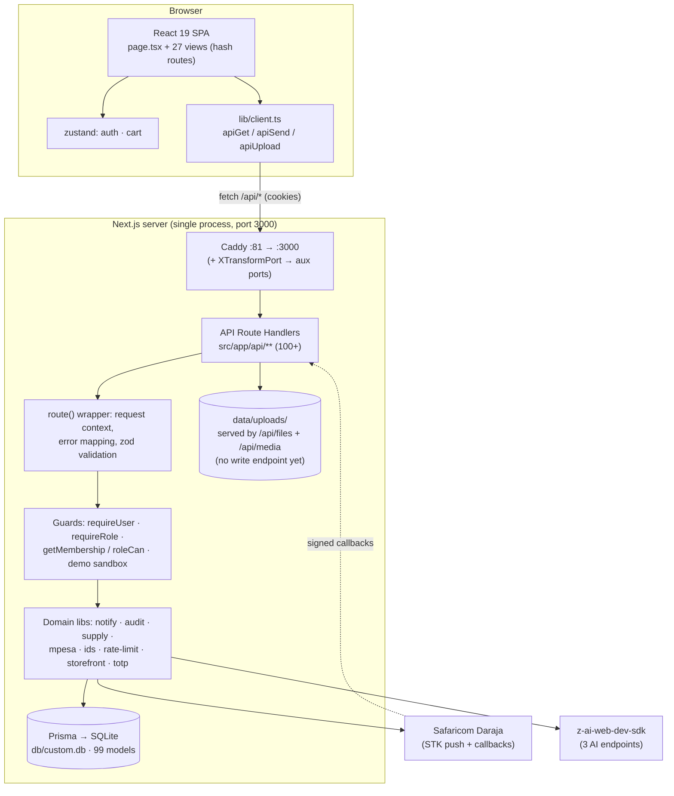
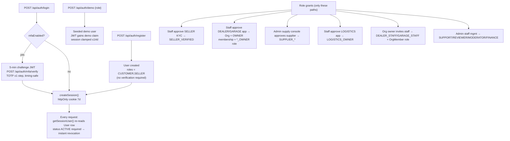
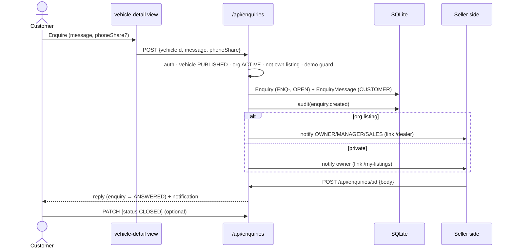
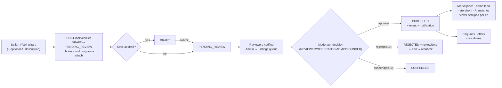
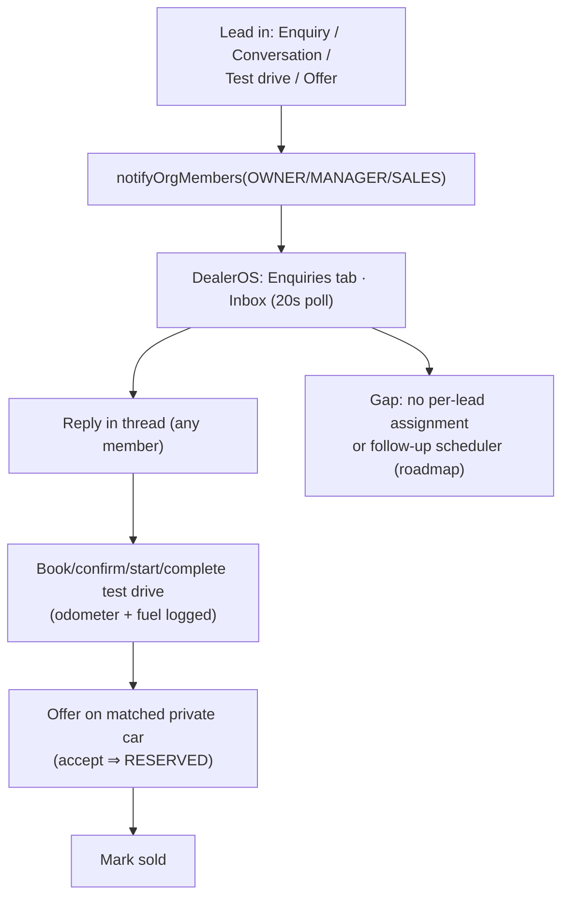
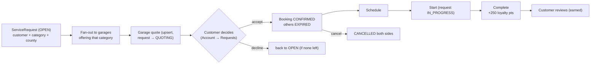
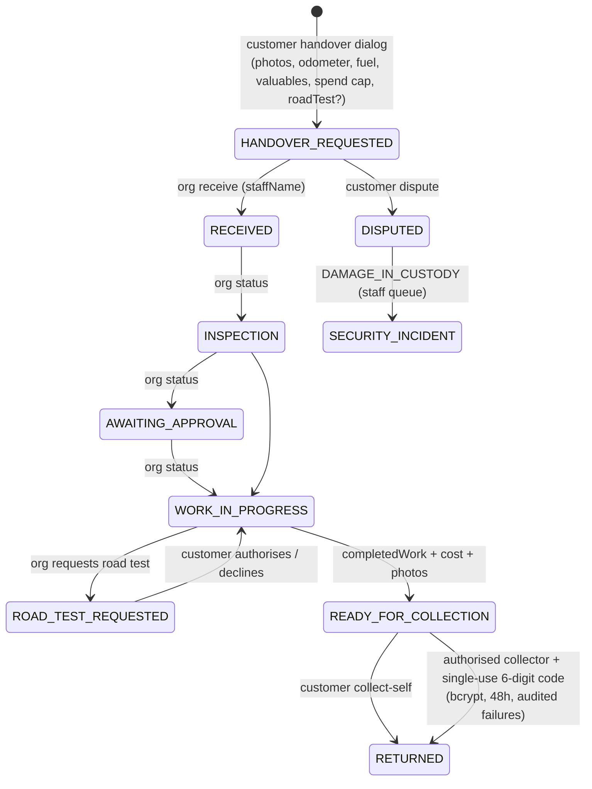
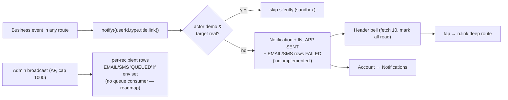
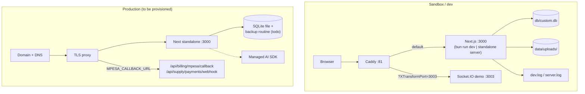

# PART 21 — COMPLETE SYSTEM DIAGRAMS

All diagrams reflect the **actual implementation** (verified against code). The full database ERD lives in [14-database-documentation.md](14-database-documentation.md).

## 21.1 Overall CARMAZE architecture



## 21.2 Frontend-to-backend request flow

```mermaid
sequenceDiagram
    participant V as View (src/views/*)
    participant C as lib/client.ts
    participant R as Route Handler
    participant G as Guards
    participant P as Prisma/SQLite
    V->>C: apiSend('/api/enquiries', 'POST', body)
    C->>R: fetch (credentials: include)
    R->>R: runWithRequestContext()
    R->>G: getSessionUser() — JWT → User row (ACTIVE?)
    G->>G: requireUser/requireRole/getMembership + demo guard
    R->>R: parseBody(zod)
    R->>P: query/mutation
    R->>P: side effects: Notification, AuditLog, *Event
    R-->>C: ok(json) | fail(status, CODE)
    C-->>V: data or ClientApiError
    V->>V: update state + toast; pollers refresh (15–20s)
```

## 21.3 Authentication and role assignment



## 21.4 Customer vehicle purchase enquiry



## 21.5 Private seller listing approval



## 21.6 Showroom lead management



## 21.7 Garage booking and repair lifecycle



## 21.8 Vehicle custody and collection



## 21.9 Subscription and payment lifecycle

```mermaid
sequenceDiagram
    participant B as Business (owner)
    participant API as /api/billing/*
    participant DB as SQLite
    participant D as Safaricom Daraja
    participant F as FINANCE (fallback)
    B->>API: POST /subscribe {planCode} (role+org checked)
    API->>DB: Invoice PENDING (desc [plan:code]) — no subscription yet
    B->>API: POST /mpesa/stkpush {invoiceId, phone} (demo blocked)
    alt no credentials
        API-->>B: 501 MPESA_NOT_CONFIGURED (attempt FAILED, audited)
    else configured
        API->>D: STK push (amount = minor/100)
        API->>DB: PaymentAttempt PENDING
        D->>API: POST /mpesa/callback (x-carmaze-signature; fail-closed prod)
        API->>API: match attempt · idempotency · amount check
        API->>DB: attempt SUCCESS → activatePaidInvoice('MPESA')
        API->>DB: Invoice PAID · Subscription ACTIVE · audit + notifications
    end
    opt manual reconciliation
        F->>API: POST /invoices/:id/mark-paid (note mandatory, audited)
        API->>DB: activatePaidInvoice('MANUAL')
    end
```

## 21.10 Notification flow



## 21.11 Database entity relationships

See the two `erDiagram` blocks in [14-database-documentation.md](14-database-documentation.md) (core platform + supply network).

## 21.12 Deployment architecture


